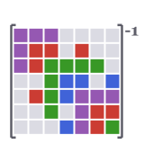

<p align="center">
  <picture>
    <source media="(prefers-color-scheme: dark)" srcset="docs/src/assets/logo-dark.svg">
    <source media="(prefers-color-scheme: light)" srcset="docs/src/assets/logo.svg">
    
  </picture>
</p>

<h1 align="center">
    SelectedInversion.jl
</h1>

<p align="center">
<strong>🔥 Quickly compute selected entries of the inverse of a sparse matrix</strong>
</p>

<div align="center">

[](https://timweiland.github.io/SelectedInversion.jl/stable/)
[](https://timweiland.github.io/SelectedInversion.jl/dev/)
[](https://github.com/timweiland/SelectedInversion.jl/actions/workflows/CI.yml?query=branch%3Amain)
[](https://codecov.io/gh/timweiland/SelectedInversion.jl)
[](https://github.com/JuliaTesting/Aqua.jl)

</div>

Sparse matrices are one of the pillars of scientific computing.
Sparse factorization methods allow us to solve linear systems involving the inverse efficiently.
But in some applications, we might need *a bunch* of entries of the inverse.
Selected inversion algorithms efficiently compute those entries of the inverse that correspond to non-zero entries in the factorization.

SelectedInversion.jl directly interfaces with CHOLMOD-based Cholesky
factorizations, which are the default for sparse symmetric positive-definite
matrices in Julia.
It also supports factorizations obtained from LDLFactorizations.jl through a
package extension, and sparse LU factorizations (UMFPACK, or KLU through a
package extension) for unsymmetric, indefinite and complex matrices.

The algorithms implemented here are directly based on SelInv [1].
The simplicial formulation is equivalent to the Takahashi recursions [2, 3].

## Contents

- [Installation](#installation)
- [Usage](#usage)
- [Performance](#performance)
- [Contributing](#contributing)

## Installation

SelectedInversion.jl is a registered Julia package.
You can install it directly from the Pkg REPL.
To do so:

1. [Download Julia (>= version 1.10)](https://julialang.org/downloads/).

2. Launch the Julia REPL and type `] add SelectedInversion`. 

## Usage

It's as simple as it can be:

``` julia
using SelectedInversion

A = ... # some sparse matrix
Z, p = selinv(A) # selected inverse and corresponding permutation vector
```

The nonzero entries of `Z` match the corresponding entries in `inv(A[p, p])`.

If you've already computed a Cholesky factorization of your matrix anyway,
you can directly pass it to `selinv` to save the factorization step.

```julia
C = cholesky(A)
Z, p = selinv(C)
```

If you don't care about this whole permutation business, use this:

```julia
Z, _ = selinv(A; depermute=true)
```

Now the nonzero entries of `Z` directly give you the corresponding entries
of `inv(A)`.

### Computing Only the Diagonal

For many applications, you only need the diagonal entries of the inverse matrix.
For example, in Gaussian Markov Random Fields, the diagonal of the inverse precision matrix gives the marginal variances.

```julia
d = selinv_diag(A)  # diagonal of inv(A)
```

This is much more efficient than computing the full selected inverse and then extracting the diagonal, especially for simplicial factorizations.

You can also pass pre-computed factorizations:

```julia
C = cholesky(A)
d = selinv_diag(C)  # same result, but reuses factorization
```

The `selinv_diag` function supports the same `depermute` keyword as `selinv`:

```julia
d_permuted = selinv_diag(A; depermute=false)  # diagonal of permuted inverse
```

### Unsymmetric, Indefinite and Complex Matrices (Sparse LU)

Cholesky-based selected inversion needs a symmetric positive-definite matrix.
For any square nonsingular sparse matrix, use a sparse LU factorization
(Julia's UMFPACK `lu`, or KLU's `klu`) and say which entries of the inverse you
need:

```julia
F = lu(A)                    # UMFPACK, with row scaling and pivoting
Z = selinv(F, B)             # inv(A) at the stored positions of B
d = selinv_diag(F)           # diag(inv(A))
```

`Z` has exactly the sparsity pattern of `B` (explicitly stored zeros included)
and is indexed like `A`, so `Z[i, j] == inv(A)[i, j]` for every stored
position; there is no permutation to undo. `B = A` gives the inverse on the
pattern of a symmetric `A`, and `B = sparse(A')` the entries needed for
`tr(inv(A) * dA)` when `A` is unsymmetric. This works for indefinite matrices
and for matrices with zeros on the diagonal, where an unpivoted `LDLᵀ`
factorization breaks down.

To repeat the computation after refactorizing a matrix with the same pattern,
reuse a workspace:

```julia
ws = LUSelInvWorkspace(F, B)
Z = float(copy(B))
lu!(F, A_new)
selinv!(Z, ws, F)            # prepared again only if UMFPACK changed its pivots
```

KLU factorizations from [KLU.jl](https://github.com/JuliaSparse/KLU.jl) work the
same way through a package extension, including KLU's block triangular form:

```julia
using KLU
F = klu(A)
Z = selinv(F, B)
klu!(F, A_new)
selinv!(Z, ws, F)            # ws = LUSelInvWorkspace(F, B)
```

KLU's refactorization can be much faster than UMFPACK's on systems with a few
dense rows and columns (such as a saddle-point system with a coupling row),
whereas reading UMFPACK's factors for `selinv!` allocates less.

The algorithm is the scalar LU selected inversion of Jacquelin, Lin and Yang
[4]. Only the entries of the inverse that the requested ones depend on are
computed from the sparse factors.

## Performance

**tl;dr**: A selected inversion costs about as much as a CHOLMOD-based Cholesky factorization.

Below is the performance of SelectedInversion.jl on some example problems from
the [SuiteSparse matrix collection](http://sparse.tamu.edu).
The benchmark was run on my laptop (M1 Max with 32 GB RAM).

To put these numbers into perspective, feel free to compare to Table III of [[1]](https://dl.acm.org/doi/abs/10.1145/1916461.1916464).
Note however the hardware difference (they used a Franklin Cray XT4 supercomputer),
as well as the different factorization algorithm (we use CHOLMOD).

| **Problem**<br>`String` | **N**<br>`Int64` | **NNZ**<br>`Int64` | **Factorization time (sec)**<br>`Measurement{Float64}` | **SelInv time (sec)**<br>`Measurement{Float64}` |
|------------------------:|-----------------:|-------------------:|-------------------------------------------------------:|------------------------------------------------:|
| bcsstk14                | 1806             | 63454              | 0.004±0.004                                            | 0.0023±0.0016                                   |
| bcsstk24                | 3562             | 159910             | 0.007±0.0013                                           | 0.0051±0.0011                                   |
| bcsstk28                | 4410             | 219024             | 0.00896±0.00082                                        | 0.0062±0.0013                                   |
| bcsstk18                | 11948            | 149090             | 0.027±0.013                                            | 0.0176±0.0024                                   |
| bodyy6                  | 19366            | 134208             | 0.0184±0.0035                                          | 0.0191±0.0022                                   |
| crystm03                | 24696            | 583770             | 0.08±0.02                                              | 0.103±0.017                                     |
| wathen120               | 36441            | 565761             | 0.0479±0.0047                                          | 0.0409±0.0029                                   |
| shipsec1                | 140874           | 3568176            | 1.107±0.065                                            | 1.144±0.063                                     |
| pwtk                    | 217918           | 11524432           | 1.332±0.07                                             | 1.292±0.03                                      |
| parabolic\_fem          | 525825           | 3674625            | 1.071±0.035                                            | 1.042±0.047                                     |
| tmt\_sym                | 726713           | 5080961            | 1.372±0.036                                            | 1.165±0.084                                     |
| ecology2                | 999999           | 4995991            | 1.282±0.099                                            | 1.385±0.044                                     |
| G3\_circuit             | 1585478          | 7660826            | 4.97±0.74                                              | 6.58833±NaN                                     |

## Contributing

Check our [contribution guidelines](./CONTRIBUTING.md).

## References

[1] Lin, L., Yang, C., Meza, J. C., Lu, J., Ying, L., & E, W. (2011). SelInv---An Algorithm for Selected Inversion of a Sparse Symmetric Matrix. *ACM Transactions on Mathematical Software (TOMS)*, 37(4), 1-19.

[2] Erisman, A. M., & Tinney, W. F. (1975). On computing certain elements of the inverse of a sparse matrix. *Communications of the ACM*, 18(3), 177-179.

[3] Takahashi, K. (1973). Formation of sparse bus impedance matrix and its application to short circuit study. In *Proc. PICA Conference*, June, 1973.

[4] Jacquelin, M., Lin, L., & Yang, C. (2018). PSelInv---A Distributed Memory Parallel Algorithm for Selected Inversion: The Non-symmetric Case. *Parallel Computing*, 74, 84-98. [arXiv:1708.04539](https://arxiv.org/abs/1708.04539)
